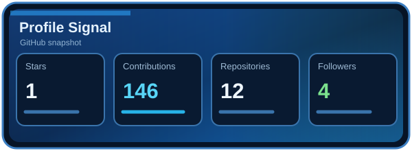
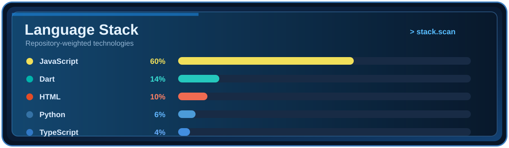
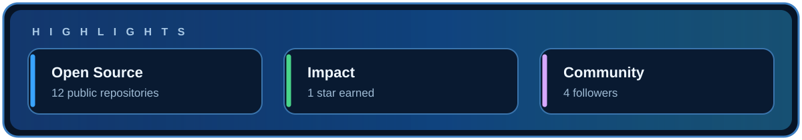

# Hey 🧑🏻‍💻 I'm yash pandey

## 📌 About Me

💡 ✏️ I build projects across web, Python, and mobile.

## 📊 GitHub Stats & Trophies

## 🛠️ Languages & Tools

### Programming Languages

  

### Frontend

  

### Backend

  

### Database

  
  

### DevOps & Cloud

  

### Tools

  

## 🔗 Connect with Me

&nbsp;

  

<strong>🐍 SNAKE TRAIL</strong> 
146 contributions, one continuous run · LIVE

 

